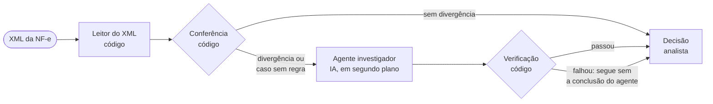
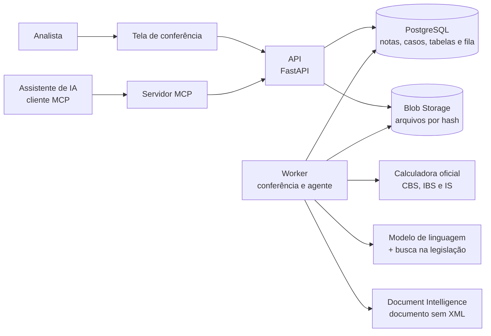

# IVA Dual Check

> Confere todos os tributos das notas fiscais de compra (NF-e), do ICMS e do IPI à CBS e ao IBS. O código acha as divergências, um agente de IA investiga cada uma em segundo plano, e o analista decide.


[](https://github.com/GuilhermeAJJ/IVA-DUAL-CHECK/actions/workflows/ci.yml)
[](https://github.com/GuilhermeAJJ/IVA-DUAL-CHECK/releases/latest)
[](LICENSE)

**Estado:** a v0.1.0 entregou a fundação: repositório, CI, ambiente local e uma API que responde ao `GET /health`. O projeto ainda não confere nenhuma nota; o [roteiro](#roteiro) mostra o caminho.

## A tese

Muito projeto com IA pluga um modelo num sistema pronto e para por aí. Este faz o caminho contrário: parte do problema e decide, etapa por etapa, o que é regra (código), o que pede julgamento (IA) e o que é decisão (pessoa).

Aqui, a IA não é um chat ao lado do sistema. É um agente que trabalha por trás dele: pega cada divergência que o código acha, investiga com ferramentas limitadas e entrega ao analista a causa provável, a base legal e uma proposta de ação. O código confere o que o agente concluiu, e o analista decide.

Cada escolha vira um ADR em [`docs/adr`](docs/adr/README.md), e a avaliação mostra com números quanto cada parte resolve.

## O problema

Quem compra precisa conferir se o imposto que veio na nota está certo, porque é dele que sai o crédito da empresa. Crédito tomado a mais pode virar autuação, e imposto destacado a menos pode ser crédito perdido.

Numa nota de compra de mercadoria, até nove tributos interessam ao comprador em 2026: ICMS, ICMS-ST, DIFAL, FCP, IPI, PIS, Cofins, CBS e IBS. Cada um tem regra própria, e as do ICMS mudam de estado para estado. Essa conferência costuma ser manual, item por item, e toda empresa do regime regular faz a sua.

A reforma tributária do consumo aumenta esse trabalho antes de diminuí-lo. De 2026 a 2033, os tributos novos (a CBS, o IBS e, a partir de 2027, o Imposto Seletivo) convivem com os antigos, que vão saindo aos poucos. Em 2026, a CBS e o IBS ainda estão em teste, e o dinheiro de verdade continua no ICMS, no IPI, no PIS e na Cofins. Mesmo assim, desde 3 de agosto de 2026, a nota de empresa do regime regular sem os campos de CBS e IBS é rejeitada.

Fontes, conferidas em 2026-09-30: a [LC 214/2025](https://www.planalto.gov.br/ccivil_03/leis/lcp/lcp214.htm), que institui a CBS, o IBS e o IS e define a transição, e o [aviso do Comitê Gestor do IBS](https://www.cgibs.gov.br/novo-marco-da-reforma-tributaria-inicia-em-03-de-agosto-com-preenchimento-obrigatorio-dos-campos-relativos-ao-ibs-e-a-cbs) sobre os campos obrigatórios.

## O que o projeto confere

Conferir todos os tributos, de todos os estados, com toda a profundidade, é construir um motor fiscal inteiro. Por isso, a conferência tem três níveis:

| Nível | O que confere | Quem faz |
|---|---|---|
| 1. Consistência | A nota fecha com ela mesma: base × alíquota = valor, a soma dos itens bate com os totais, o CST combina com os campos preenchidos, o CFOP combina com a operação e a NCM existe | Código, em todos os tributos |
| 2. Tabela oficial | O IPI pela TIPI, o ICMS entre estados pelas resoluções do Senado, a lista da substituição tributária pelo Convênio ICMS 142/2018 e a CBS, o IBS e o IS pela calculadora oficial, sempre com a tabela que valia na data da nota | Código |
| 3. Legislação estadual e regime do comprador | ICMS interno, margem da substituição tributária, DIFAL, FCP, benefícios fiscais e crédito de PIS e Cofins, de um estado na primeira versão | Código no que já virou regra; o agente no caso que a regra não resolve |

A nota de serviço (NFS-e), com o ISS e as retenções, fica para depois da v1.0.0.

## Como funciona



| Etapa | Quem faz | Por quê |
|---|---|---|
| Ler o XML da nota | Código | O XML é estruturado e é o documento legal |
| Conferir os tributos | Código | É regra, com a tabela da data da nota, e não admite erro de modelo |
| Investigar a divergência e o caso sem regra | Agente de IA | O caminho da investigação depende do que ele vai achando |
| Verificar a conclusão do agente | Código | Alíquota, citação e ação proposta são verificáveis |
| Decidir | Analista | A responsabilidade fiscal é de uma pessoa |

A leitura de documento sem XML entra na v0.8.0, com o Azure AI Document Intelligence e o resultado conferido por código.

## O agente investigador

O agente roda no worker, sem ninguém pedir, para cada divergência que a conferência acha e para cada caso que a regra não resolve. Ele junta as evidências e entrega o caso pronto para o analista: a causa provável, a base legal e uma proposta de ação.

> **Exemplo (fictício).** O produto da nota está na lista da substituição tributária, mas a nota não traz ICMS-ST. A regra sozinha diria só "ST faltando?". O agente confere se existe acordo de substituição tributária entre o estado do fornecedor e o do comprador, porque, entre estados, a ST depende desse acordo ([LC 87/1996, art. 9º](https://www.planalto.gov.br/ccivil_03/leis/lcp/lcp87.htm), conferido em 2026-10-24). Também olha as notas anteriores do mesmo produto. Se não há acordo, a nota não está errada, e ele registra o porquê, com a citação. Se há, ele confere as exceções do acordo e, se a falta se confirmar, propõe a ação, que só sai com a aprovação do analista.

| O agente pode | O quê |
|---|---|
| Ler | A nota, as tabelas oficiais, a calculadora oficial, a legislação (com artigo e inciso), o perfil do fornecedor nos dados abertos do CNPJ e o histórico de notas e decisões |
| Fazer sozinho | Registrar o achado no caso, porque é interno e reversível |
| Propor | Um ajuste e o rascunho de um pedido de correção ao fornecedor. O analista aprova, edita ou descarta |
| Nunca | Transmitir à Sefaz, lançar no ERP, pagar ou usar ferramenta genérica (SQL, HTTP ou shell livres) |

O código confere o que o agente concluiu: se as alíquotas batem com a tabela da data da nota, se cada trecho citado existe e é literal e se a ação está na lista permitida. Texto escrito por terceiros entra como dado, nunca como instrução.

## Como provar

Um gerador de NF-e sintéticas planta erros, e cada um sai rotulado pelo tipo e pela causa, como alíquota errada, NCM errada, ST que faltou, CST incoerente ou nota sem CBS e IBS. Com o rótulo da causa, a avaliação mede o diagnóstico, e não só a detecção.

As mesmas notas passam por três braços:

- **A:** regras, com a explicação num texto fixo;
- **B:** regras e uma chamada de LLM;
- **C:** regras e o agente.

As métricas são a detecção por tipo de erro, o acerto da causa, as citações conferidas, a adequação da ação à causa e o custo e a latência por caso. É a avaliação que diz se o agente vale o que custa.

## Arquitetura



## Roteiro

| Versão | Entrega | Status |
|---|---|---|
| v0.1.0 | Fundação: repositório, fluxo de trabalho, CI e esqueleto | Lançada |
| v0.2.0 | Ler e guardar a nota: o leitor do XML da NF-e, com todos os grupos de tributo, e notas de amostra fictícias | Próxima |
| v0.3.0 | Nível 1: a consistência de todos os tributos | Planejada |
| v0.4.0 | Nível 2: tabelas oficiais e calculadora | Planejada |
| v0.5.0 | Tela de conferência e gerador de notas sintéticas | Planejada |
| v0.6.0 | Agente investigador e avaliação A/B/C | Planejada |
| v0.7.0 | Nível 3 de um estado, com a base legal verificada | Planejada |
| v0.8.0 | Documento sem XML e servidor MCP | Planejada |
| v1.0.0 | Tudo acima, estável | Planejada |

Depois da v1.0.0: outros estados, a nota de serviço (NFS-e), um monitor de mudanças na legislação e a conciliação das notas com o extrato bancário.

## Stack

- Python 3.12, FastAPI, SQLAlchemy 2 e Alembic
- PostgreSQL com pgvector
- Azure Blob Storage (Azurite no desenvolvimento)
- Calculadora de Tributos oficial da Receita Federal, para a CBS, o IBS e o IS
- Modelos de linguagem no Microsoft Foundry (Azure OpenAI), com chamada de ferramentas
- Azure AI Document Intelligence
- MCP (Model Context Protocol)
- Docker Compose, GitHub Actions, uv, Ruff e pytest

## Como rodar

Só precisa do [uv](https://docs.astral.sh/uv/getting-started/installation/). Na primeira execução, ele baixa o Python 3.12, se faltar, e instala as dependências.

```sh
uv run uvicorn iva_dual_check.main:app --reload
```

A API sobe em `http://127.0.0.1:8000`, e o `--reload` a reinicia a cada mudança no código. O `GET /health` responde `{"status": "ok"}`, e a documentação interativa fica em `/docs`.

Testes e lint:

```sh
uv run pytest
uv run ruff check
uv run ruff format --check
```

O [CI](.github/workflows/ci.yml) roda esses três comandos em todo PR e em todo push na `main`, junto com a varredura de segredos do histórico inteiro.

## Ambiente local com Docker

Sobe a API, o PostgreSQL 18 com pgvector e o Azurite, que emula o Azure Blob Storage, sem conta no Azure. Precisa do Docker com o Compose v2.

```sh
cp .env.example .env
docker compose up --build --wait
```

O `--wait` só devolve o terminal quando os três serviços estão saudáveis. Depois disso:

- a API responde em `http://127.0.0.1:8000/health`;
- o PostgreSQL fica em `127.0.0.1:5432`, com o usuário, a senha e o banco do `.env`;
- o Blob Storage do Azurite fica em `http://127.0.0.1:10000`.

As portas só abrem em `127.0.0.1`, então nenhum serviço fica acessível de outra máquina da rede. Para parar, `docker compose down`; para apagar também os dados, `docker compose down --volumes`.

## Como trabalhamos

Kanban no [GitHub Projects](https://github.com/users/GuilhermeAJJ/projects/1): uma tarefa é uma issue, uma branch e um pull request. Os commits seguem o [Conventional Commits](https://www.conventionalcommits.org/pt-br/v1.0.0/), e as versões seguem o [Versionamento Semântico](https://semver.org/lang/pt-BR/). O passo a passo está no [guia de contribuição](CONTRIBUTING.md). Falha de segurança se relata em privado, como explica a [política de segurança](SECURITY.md).

## Autoria

Arquitetura, decisões e revisão: Guilherme Justino. O código é escrito em par com o Claude (Anthropic) e só entra na `main` depois de revisado.

## Aviso

Projeto de estudo e portfólio. Usa apenas dados fictícios e não é consultoria tributária. A legislação muda com frequência, e a reforma ainda está sendo regulamentada: cada regra do projeto registra a fonte e a data em que foi conferida.

## Licença

[MIT](LICENSE)
